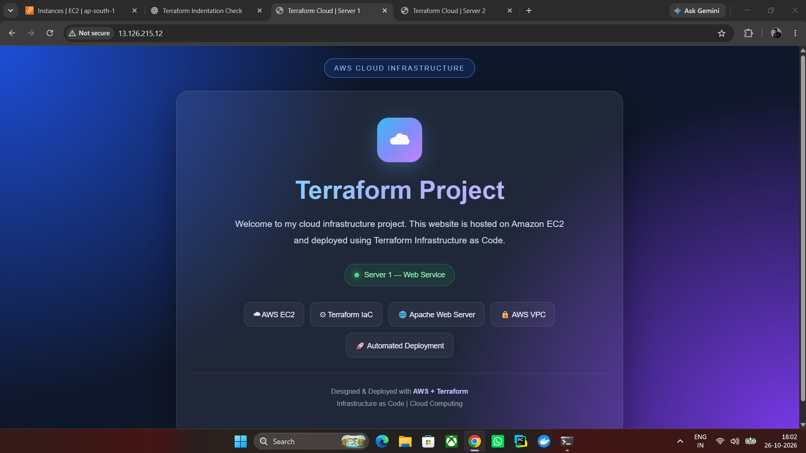
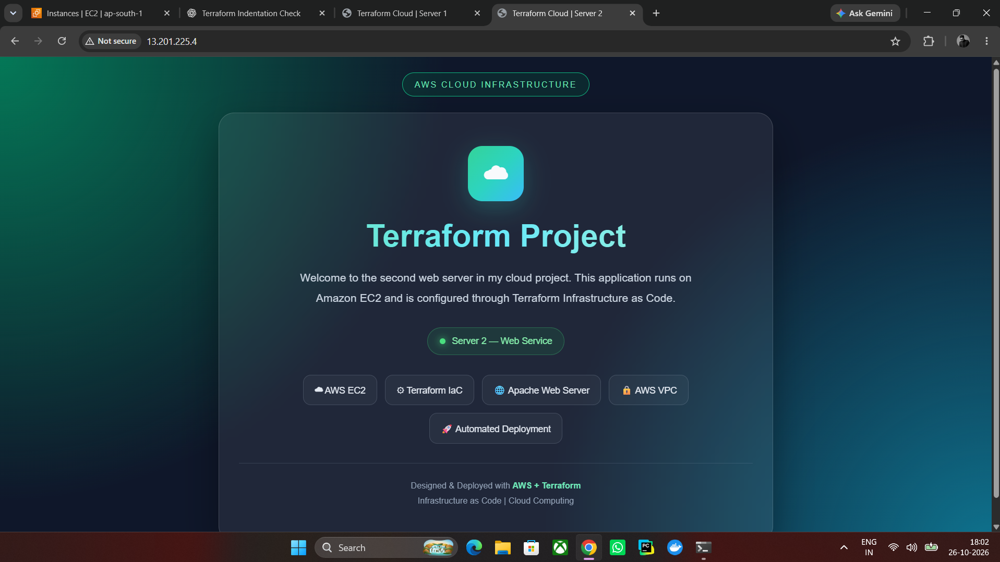
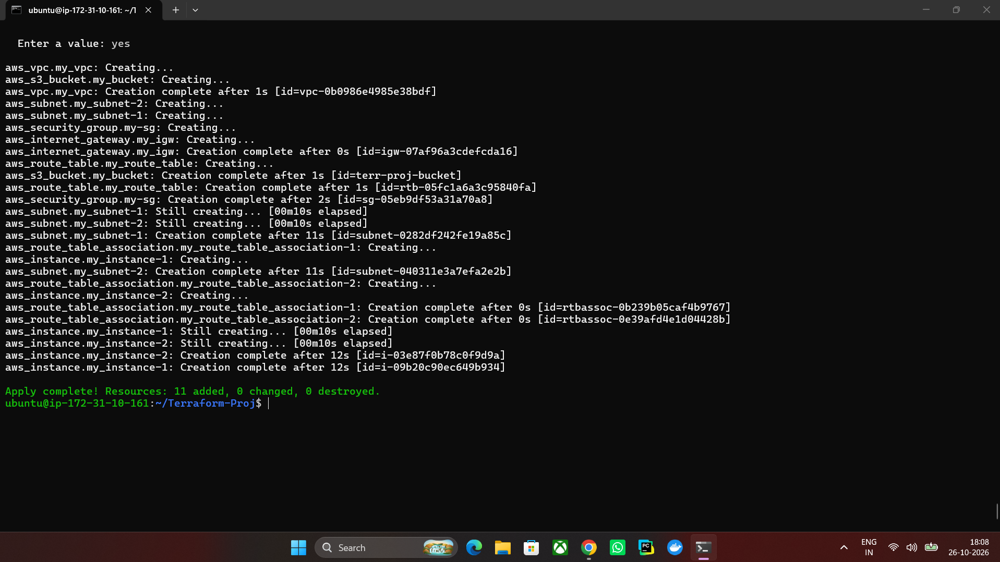
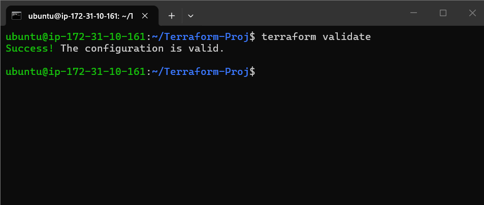

# 🚀 AWS Cloud Infrastructure Deployment Using Terraform

## 📌 Project Overview

This project demonstrates the deployment of AWS cloud infrastructure using Terraform (Infrastructure as Code).

The infrastructure includes a custom Amazon VPC, two subnets, an Internet Gateway, route tables, security groups, two Amazon EC2 instances, and an Amazon S3 bucket.

Two Apache web servers are deployed on Amazon EC2 using Terraform automation.

## 🛠️ Technologies Used

- ☁️ Amazon Web Services (AWS)
- 🏗️ Terraform (Infrastructure as Code)
- 🖥️ Amazon EC2
- 🌐 Amazon VPC
- 🔐 AWS Security Groups
- 🛣️ Route Tables
- 🌍 Internet Gateway
- 📦 Amazon S3
- 🐧 Ubuntu Linux
- 🌐 Apache Web Server
- 💻 Git and GitHub

## 🏗️ Infrastructure Components

| Component | Description |
|---|---|
| VPC | Custom Virtual Private Cloud |
| Subnets | Two subnets in separate Availability Zones |
| EC2 Instances | Two web server instances |
| Internet Gateway | Provides internet connectivity for eligible resources |
| Route Table | Controls network traffic routing |
| Security Group | Controls inbound and outbound traffic |
| S3 Bucket | Object storage resource |
| Apache | Hosts the web applications |
| Terraform | Automates infrastructure provisioning |

## 📸 Output & Screenshots

### Server 1: Web Service

### Server 2: Web Service

### Terraform Apply

### Terraform Validate

**Deployment Result:**
- 11 resources added
- 0 resources changed
- 0 resources destroyed

## 🎯 Project Objectives

- Understand Infrastructure as Code using Terraform.
- Provision AWS resources automatically.
- Configure a custom VPC and subnets.
- Deploy multiple EC2 web servers.
- Configure network routing and security groups.
- Host web applications using Apache.
- Validate and manage infrastructure using Terraform commands.
- Document cloud infrastructure projects using GitHub.

## 👨‍💻 Author

Salauddin

Cloud Computing | AWS | Terraform | Infrastructure as Code

---
